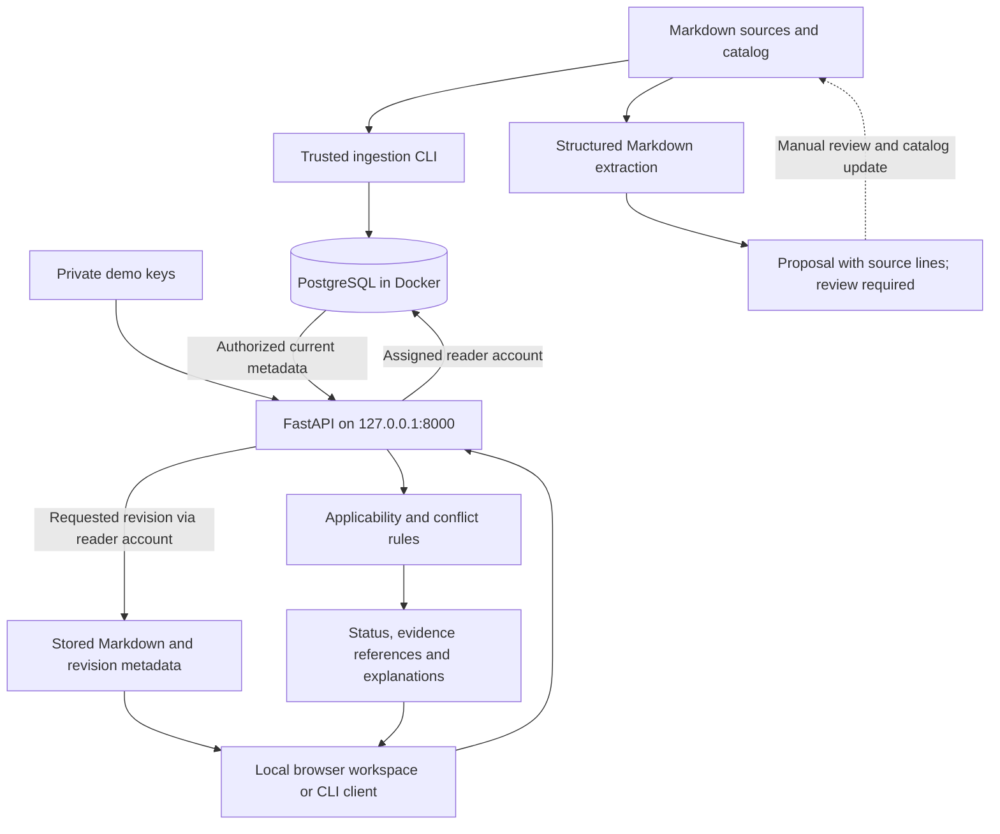

# Architecture and current scope

OpsLens is a local operational-evidence prototype. It selects applicable fictional runbooks and explains conflicts or uncertainty using explicit metadata. No LLM or cloud inference is involved.

## Storage and trust boundaries

`documents` stores each document's current revision and allowed roles. `document_versions` stores immutable revisions of content and metadata with checksums. PostgreSQL row-level security filters both tables through the actual reader login. The platform, security, and intern accounts can select permitted rows but cannot write or assume other reader roles.

The API derives the role from a bearer key. The CLI's `--role` flag is a trusted operator test input, not authentication. The machine owner controls all demo keys and database passwords. Administrative database access and filesystem access remain trusted; public fictional fixtures are not confidential data.

Version rows reject ordinary updates/deletes, but administrators can bypass protections. Permission changes apply to historical revisions too. Repeating an unchanged revision is a no-op; content/metadata edits require a new revision. Stale imports cannot move the current revision backward. Removing a catalog entry does not revoke its stored copy.

PostgreSQL is exposed at `127.0.0.1:55432` and persists in a named Docker volume. The API runs directly in the project Python environment. pgvector is installed and tested, but no embeddings or semantic search are implemented.

## Selection and extraction

Selection filters permissions before inspecting metadata for explanations. It checks approval, service, exact numeric software versions, environment, verification, and required key-rotation context. Conflicts compare explicitly normalized `must`/`must_not` catalog rules. Conflict takes precedence over uncertainty, which takes precedence over selection. Every non-selected result has no recommendations.

Extraction reads explicit Markdown fields and proposes values with provenance. It cannot grant approval or permissions and never automatically modifies the catalog or database. General prose extraction, AI inference, and automatic proposal publication are future work.

## Implemented and remaining

Implemented: local Python setup, persistent PostgreSQL, revision ingestion, restricted readers, deterministic selection, bearer-authenticated API, structured metadata proposals, actionable response fields, authorized historical document retrieval, a browser workspace with cited-passage viewing, automated tests, and required CI.

Remaining: verified human login/OIDC, general document parsing, local LLM integration, vector retrieval, semantic contradiction detection, saved answers/audit history, background workers, and live service context. Conflict responses include manually authored, validated source-line quotations where provided; other claims can remain explicitly uncited. Automatic claim-to-passage alignment is future work.

See [setup](../SETUP.md), [API](api.md), [extraction](metadata-proposals.md), and [testing](testing.md).
