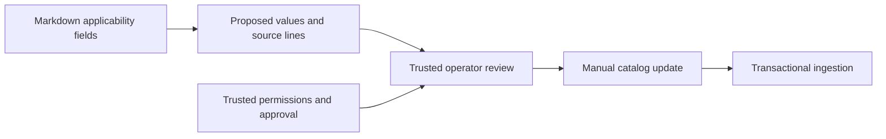

# Metadata proposals and result explanations

See also [setup](../SETUP.md), [the API contract](api.md), and [the authoring template](runbook-template.md).

## Extraction contract

Run `.venv/bin/python -m opslens.extraction docs/runbook-template.md` to propose metadata from a UTF-8 Markdown file (maximum 1 MB). This trusted local operator command does not call the database, use an API key, call a model, or publish anything. Its output can contain source passages; keep output as private as the input document.

The first extractor supports an explicit `## Applicability` section with one field per line:

```text
service: identity-service
environment: production
version_min: 2.4.0
version_max_exclusive: 2.5.0
key_rotation_enabled: true
```

An optional `- ` prefix is accepted. Field names, section heading, and enum values are case-sensitive. The first-level Markdown title is proposed only when exactly one exists. Code fences are ignored; applicability ends at the next level-one or level-two heading. This intentionally limited parser does not infer values from general prose, tables, PDFs, document names, or the existing catalog.

`key_rotation_enabled` accepts `true`, `false`, or `none`. Explicit `none` means no key-rotation requirement. A missing field is omitted from the proposal and flagged; it is not silently converted to no requirement. Missing, invalid, or repeated fields require review. Repeated identical values are also ambiguous. Empty or inverted version ranges are removed from proposed metadata and flagged.

Output includes:

- `proposed_metadata`: supported, unambiguous values only.
- `provenance`: original source lines, one-based line numbers, and raw values, including ambiguous candidates.
- `source_sha256`: fingerprint of the UTF-8 source used for this proposal.
- `issues`: fields that could not safely be proposed and machine-readable reasons.
- `review_required`: always true, even when the proposal is complete.
- `schema_version` and `extractor`: identify the proposal format and parsing method.

Source text cannot set allowed roles, publication status, verification status, or the review requirement. The extractor does not generate normalized conflict claims either. It supplies no authority to approve or publish a document.

## Review and publication

1. Run extraction on the intended local source.
2. Review proposed values against their cited lines. If the source has changed, regenerate the proposal; do not rely on stale line numbers or a stale fingerprint.
3. Resolve missing/ambiguous values with the document owner. Set permissions and approval separately through the trusted catalog workflow. A complete proposal is not proof that its assertions are accurate.
4. Transfer reviewed metadata into the catalog. Supply the document ID, revision, source path, verified claims, and trusted policy fields. For an existing document, content or metadata changes require a new revision.
5. Use the existing ingestion command, which validates and publishes the batch transactionally.

Review transfer is manual in this slice. The browser now stores private drafts and displays extraction proposals, source lines, and issues. It provides no editing, approval, publishing, automatic promotion, or background worker; see [draft intake](drafts.md). Existing fictional source files and stored revisions are unchanged. Running extraction on the existing prose-only runbooks will report missing applicability fields rather than borrow uncited values from the catalog.

## User-facing selection responses

The API and both CLI paths retain existing status, recommendation, conflict-ID, and evidence fields. Additive fields now explain the outcome:

| Field | Meaning |
|---|---|
| `message` | Plain-language description of the result |
| `next_steps` | Suggested follow-up actions; not automatic remediation |
| `questions` | Specific missing-context questions with field names and supported answers |
| `review_items` | Authorized document title, ID, revision, path, and metadata-review reasons |
| `conflict_details` | Opposing normalized rules, action, and authorized document references |

For an unknown key-rotation setting, one question asks whether it is enabled. Missing document metadata is separately listed for review. Both may appear together. Conflict remains the highest-priority overall status if applicable documents disagree; other outstanding questions and reviews are still returned.

Conflict details explicitly use `basis: catalog_rules`. They describe manually normalized claims, not verbatim procedure quotes or automatically interpreted contradictions. Authorized document content is available through the revision endpoint described in [the API contract](api.md#document-revision-retrieval). Optional [claim citations](citations.md) now provide exact source passages separately from the normalized rules. References must not be rendered as if the normalized rule text were a direct quotation.

Insufficient-evidence messages say that suitable guidance the caller can access was not found. They do not reveal whether inaccessible documents exist. All explanations are constructed after role filtering. The CLI displays these fields as JSON. The browser workspace shows messages, context questions, review reasons, and conflict comparisons. It does not approve or publish metadata proposals.



